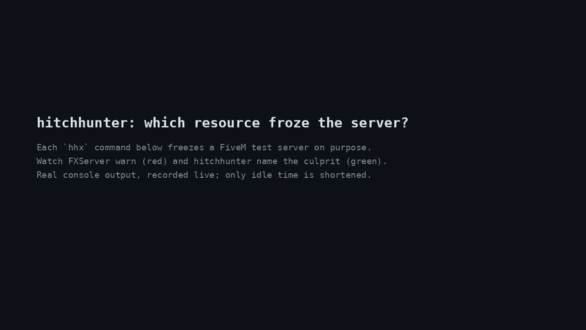

# hitchhunter

Finds **which resource** causes the three hitch warnings FXServer prints:

```
server thread hitch warning: timer interval of 412 milliseconds
network thread hitch warning: timer interval of 230 milliseconds
sync thread hitch warning: timer interval of 188 milliseconds
```

FXServer never says who did it.



(Real console output, recorded live on a test server: each `hhx` command freezes the server on purpose, FXServer warns
in red, hitchhunter names the culprit in green. [MP4](docs/hitchhunter-demo.mp4), [how it was made](docs/demo/README.md).)

hitchhunter puts a small wrapper inside every resource (one line in each `fxmanifest.lua`, written by
`tools/inject.py`), times what each resource's code does on the server thread and counts what it sends. When a hitch
happens it tells you what was running at that moment:

```
[hitchhunter] #2 server 372 ms | 0 players | hh_lua_a event hh_lua_a:busy server.lua:13 200 ms; hh_lua_a export heavy 150 ms; hh_lua_b event hh_lua_b:go server.lua:5 20 ms
```
(from the test resources in `test/`: `hh_lua_b`'s handler spent 20 ms itself, then called `hh_lua_a`'s export and
event, which took 150 and 200 ms.)

`hh show` gives the whole report: which handler, thread or export ran, its own time and what it called, the time
spent outside any wrapped script, the player and entity counts, the machine's load, and for network / sync hitches
what was sent or created in the seconds before.

> **Escrowed (encrypted) resources are intercepted too.** Escrow encrypts a resource's scripts, not its
> `fxmanifest.lua`, so the wrapper line goes in exactly like everywhere else and loads first in the same runtime.
> Their event handlers, exports, commands, callbacks, threads and timeouts are timed and named like any other code,
> and their sends, entities, state bags and file reads are counted. The only thing hidden is the source file name:
> escrowed code shows as `escrow:<line>` (for example `vendor_res thread escrow:4568`).
> Checked on a 183-resource server: every escrowed resource with server scripts was wrapped.
> [Details](#escrowed-encrypted-resources).

## Trust: what it does and does not do

* **Nothing leaves your server.** No telemetry, no update check, no outside request. The only network call is the
  optional Discord webhook you set yourself (`hitchhunter_webhook`, off by default).
* **No FXServer file is modified** (`scheduler.lua`, `main.js`... stay stock) and **no escrowed (encrypted) file is
  read, decrypted or changed**: only one plain-text line per `fxmanifest.lua`, recorded with before / after hashes.
* **Nothing hidden**: every file is plain Lua / JS / Python, MIT licensed, about 2,500 lines. No obfuscation, no
  binary, no download at run time.
* **It does not change what your resources do**: same arguments, return values, errors and timings of their own code
  (checked, see [Safety evidence](#safety-evidence-what-is-proven-and-how-to-check-it-yourself)).
* **It never stops anything**: no `dependency` line, so stopping or deleting hitchhunter never stops another resource;
  `set hitchhunter_inject 0` turns every wrapper off at the next start.
* **It leaves nothing behind**: `inject.py --remove --apply` takes the lines out, `inject.py --verify` proves every
  manifest is byte-identical to before and that no config line or cache copy is left
  (see [Removing it completely](#removing-it-completely-no-residue)).

## How it works

* **Wrapper, server side, in every resource, escrowed (encrypted) ones included** (`inject/server.lua`,
  `inject/server.js`). Measures the CPU time of every
  event handler, callback / export call, command, state bag handler, thread and timeout, cut at each `Wait` / `Await`
  (waiting never counts). Time spent in a nested handler of the same resource is not counted twice. It also counts
  `TriggerClientEvent` / `TriggerLatentClientEvent` bytes (x players for `-1`), `TriggerEvent`, state bag writes,
  entity natives (`CreateVehicle`, `CreatePed`, `CreateObject`, `DeleteEntity`, routing buckets...), and times
  blocking calls (`LoadResourceFile`, `SaveResourceFile`, `io.open`, `json.encode` / `decode`).
  Arguments, return values and errors are passed through unchanged.
* **Collector** (`server/main.lua`). Detects hitches two ways: its own frame timer (every server frame longer than
  `Config.frameHitchMs`, 100 ms by default, so also the ones FiveM does not print) and the console warnings
  (`RegisterConsoleListener`). It gathers the slices that overlapped the freeze and builds the report.
* **Machine** (`server/host.js`): load, how busy all cores are, FXServer's own CPU. When the freeze is not in any
  wrapped script and the machine is overloaded, or every thread stalls at once, the cause is the machine (or the
  engine), not a resource, and the report says so.

## What it finds, and how

What happens when the server hitches, step by step:

1. **While the code runs** (inside each wrapped resource): every handler, thread, callback, export, timer is timed
   as it runs. A block that held the server thread 5 ms or more is sent to the collector at once with its exact
   start and length ("span"). Everything else adds up in counters (time per handler, sends, state bags, entities,
   file / json calls) kept inside the resource.
2. **The freeze is noticed**: the collector's frame thread sees a gap of 100 ms or more between two server frames
   (it could not run while something blocked the thread), and / or FXServer prints its `hitch warning` for the
   server, network or sync thread.
3. **400 ms later the report is built**: the spans inside the freeze, who contains whom (a handler that called
   another resource's export contains it: own time vs total), what is left unexplained, and around it: players,
   entities, the machine's load, and when the scripts do not explain it, what the resources did in the seconds
   before (entities created / removed and by whom, entity natives, state bag writes, client events sent).
4. **It is written**: one line in the console (`Config.console`), the whole report in `logs/hitches-*.jsonl`,
   `hh last` / `hh show`, Discord if set.

What each kind of problem looks like (real reports from the test resources and a copy of a 183-resource server):

| the problem | how hitchhunter sees it | what the report says |
|---|---|---|
| an event handler doing too much | the handler runs through `Citizen.CreateThreadNow`, timed from start to end | `hh_trigger event hh_trigger:busy server.lua:21 300 ms` |
| a thread with a heavy loop | the thread's slices between two `Wait` | `clothing_res thread server/templates.lua:497 869 ms` |
| a slow export called from another resource | the export is timed in its own resource; the caller's own time is paused meanwhile | `hh_trigger export busy 200 ms; hh_trigger event hh_trigger:nested 21 ms` (own time of each) |
| a big file write / read, a huge json | `SaveResourceFile`, `LoadResourceFile`, `io.open`, `json.*` timed one by one | `io json.decode 351 ms`, `io SaveResourceFile big.tmp 21 ms`; `hh io`: "18818 LoadResourceFile, 877 ms" |
| restarting a resource on a live server | `onResourceStarting` to `onResourceStart` | `clothing_res resource start (loading its scripts) 47 ms`, then its thread; `hh starts` |
| a JS handler, timer, `setTick`, code after `await` | handlers by name; the tick in phases (the resource's first timer and first ticker mark them) | `event hh_trigger:js 200 ms`, `js timers (setTimeout / setInterval) 220 ms`, `js setTick + code after await 160 ms` |
| many small calls adding up (no single big freeze) | the counters: own time per handler, per minute | `hh top`: "ms/min, calls, average, longest" per handler and per resource |
| the engine working after a script (entities, state bags) | the freeze is outside every span; the counters of the seconds before are compared | "296 ms outside wrapped scripts (the engine at work). In the 23 s before: 2000 entities created and 2000 removed; hh_trigger called CreateObjectNoOffset 2000 times" |
| a network thread hitch | FXServer's warning; the sends of the seconds before (bytes x players) | `network 617 ms` + "sent ... KB", `hh net` |
| a sync thread hitch | FXServer's warning; every entity created / removed (players' games and scripts) and by whom, entity natives, state bags | "412 entities created in the last 30 s (most by Name [12]: 380)", `hh sync` |
| the whole process stalled (machine overloaded, VM pause, disk / swap) | the three threads stall at once while no wrapped script runs; the machine's CPU / load | `server 558 ms + network 516 ms + sync 512 ms`, "the whole process was held up ... not one resource script" |
| C#, FiveM's own resources, a resource without the wrapper | the freeze is outside every span | "outside wrapped scripts"; `hh coverage` lists the unwrapped ones |

## Safety evidence: what is proven, and how to check it yourself

No test can prove that nothing will ever break for every resource ever written. What follows is what was checked,
with the tools to repeat each check on your own server (do it on a test copy first: the test resources freeze the
server on purpose).

| claim | how it was checked | repeat it |
|---|---|---|
| resources behave the same | `test/resources/hh_sem` runs 34 checks (event arguments with `nil` holes, export returns and errors, error messages, `Await` resolve / reject, commands, `RemoveEventHandler` / `removeEventListener`, state bags, files, json, JS timers / ticks / promises) with the wrapper and without (`hitchhunter_inject 0`): identical output | `grep SEM` in both consoles, sort, diff |
| a real server boots the same | a copy of a 183-resource ESX Legacy server booted twice, wrapper off then on: the same 54 error lines, no new error, none changed; 112 Lua + 4 JS runtimes wrapped | diff the `SCRIPT ERROR` / `Failed to load` lines of two boots |
| the injector cannot damage a manifest | all 274 manifests of a production server run through `inject.py --apply` with writes redirected: every result valid Lua (`luac -p`), only hitchhunter's lines added, no other byte changed, CRLF and BOM kept; 13 unit tests in `test/test_inject.py` | `python3 -m unittest discover -s test -p 'test_*.py'` |
| removal is exact | `--remove --apply` then `--verify` on 116 manifests: all 116 byte-identical to before hitchhunter | `inject.py --remove --apply && inject.py --verify` |
| cheap | ~1 µs per handler / export call, 0.1 µs per `TriggerClientEvent` / json call, nothing on `Wait` | `test/resources/hh_bench`, with and without the wrapper |
| it fails safe | every counter and the console listener run in `pcall`; per-resource tables capped at 3,000 keys; at most 40 messages per second per resource; the client copy of the wrapper returns at its first line (`test/client-guard.js`) | read `inject/server.lua`, `inject/server.js` |

**What can still differ** (all known, none seen to break a resource):
* a `SCRIPT ERROR` traceback has one more line, from `@hitchhunter/inject/server.lua`;
* `debug.getinfo(Citizen.CreateThread)` and the like point at hitchhunter's file;
* a resource that compares function identities (`Wait == someSavedWait`) or replaces these same functions itself
  sees hitchhunter's versions;
* tested on Linux (FXServer 37655, 38435), not yet on a Windows server.
If anything looks wrong: `set hitchhunter_inject 0` (next start) or `inject.py --remove --apply`.

## Removing it completely (no residue)

What hitchhunter can leave on a server, all of it: the line in each manifest, its lines in `server.cfg`, its own
folder (with `logs/`), FXServer's cached copy of its files (`cache/files/hitchhunter`), and in memory the replaced
functions (gone when each resource restarts). It writes nothing else: no database, no KVP, no file anywhere else.

1. `python3 tools/inject.py --remove --apply` (every manifest gets its original bytes back).
2. Remove `ensure hitchhunter`, `add_ace ... command.hh ...` and any `set hitchhunter_*` from `server.cfg`.
3. Stop the server, delete `cache/files/hitchhunter`.
4. `python3 tools/inject.py --verify`. It must end with:
   ```
   manifests changed by inject.py (logs/inject.log): 116
     byte-identical to before hitchhunter: 116
   NO RESIDUE: no manifest loads the wrapper, no config line, no cache copy. Last step: delete the folder ...
   ```
   Anything left is listed (`RESIDUE FOUND`: which manifest, which config line, the cache folder) and the command
   exits with code 1. A manifest a vendor update replaced after injection shows as "different from before
   hitchhunter" but is checked for leftover lines like the others.
5. Delete the `hitchhunter` folder and start the server: every resource is stock.

Players' FiveM caches may keep the small `inject/server.lua` file they downloaded; no manifest loads it any more, so
it never runs again, and FiveM clears its cache by itself.

## Escrowed (encrypted) resources

**Covered like any other resource.** FiveM's escrow encrypts a resource's script files, not its `fxmanifest.lua`, so
`inject.py` adds the line there too. The line loads hitchhunter's own file (not encrypted) first in the same
runtime; the escrowed code then registers its handlers, threads and exports through the replaced functions, which
time them like any other.

Checked on a copy of a 183-resource server: 57 escrowed resources, the 35 with server scripts all wrapped (`hh
coverage`, `status.json`); the other 22 are asset-only (props, maps, MLOs) with no server script, so nothing to time.

What a report knows about escrowed code, and what it cannot:

| known | not known |
|---|---|
| the resource; what ran (event / export / command / thread / timeout / callback) with the event, export or command name; the line its function starts on; own and total time; what it sent, created, wrote to state bags; the file names it read or wrote (`io LoadResourceFile data.json`) | the source file name: FiveM strips the debug info of escrowed code, so the label shows `escrow:<line>` instead of `<file>:<line>` |

Examples (real labels): `vendor_res thread escrow:4568`, `vendor_res event onResourceStart escrow:6743`,
and a file the vendor left unencrypted (`escrow_ignore`) keeps its name: `callback server/other.lua:390`.
A vendor update replaces the manifest: run `inject.py --apply` again after updating.

## Coverage: what is seen, what is not

**Seen and named** (resource + handler / thread / export / file and line):
* Lua server code of every wrapped resource: event handlers, ref calls (exports, callbacks, commands, state bag
  handlers), threads, timeouts.
* JS / TypeScript server code: event handlers and exports by name; timers and `setTick` + code after `await` per
  resource (`setTick` / `setTimeout` are read-only in FiveM, so not per callback).
* Resource starts, wrapped or not (loading a resource's scripts runs outside any handler): `hh starts`, and a
  `resource start` line in reports.
* Blocking calls inside the code: `LoadResourceFile`, `SaveResourceFile`, `io.open`, `json.encode` / `decode`.
* **Escrowed (encrypted) resources: all of the above**, by resource and event / export / command name; the source
  file name is replaced by `escrow:<line>`.

**Seen, not named** (shown as "outside wrapped scripts", with the context):
* Engine work on the server thread: OneSync bookkeeping, resource stops, FiveM's own resources (`chat`, `yarn`,
  `webpack` builds, txAdmin's `monitor`), C# resources, a resource started without the manifest line.
* The network and sync threads: the engine's own warning says how long; the report adds what was sent, written to
  state bags, created as entities (by whom) just before, and the machine's load.

**Not seen:**
* Client side (players' games): only the server's three threads.
* Main-thread freezes under `Config.frameHitchMs` (100 ms); network / sync stalls under the engine's own warning
  threshold (it only prints from 150 ms on).

## How hitches are detected (no engine patch)

FXServer runs three threads that can hitch. hitchhunter sees them without touching the engine:

* **Server (main) thread, its own timer.** `server/main.lua` runs a Lua thread that does `Wait(0)` in a loop: it
  is resumed once per server frame (FXServer runs at 20 Hz, so every ~50 ms) and notes the time (`os.nanotime`).
  Every resource script runs on this same thread, so while something blocks it, that loop cannot run either: a gap
  of `Config.frameHitchMs` (100 ms) or more between two frames IS a main thread freeze, measured to the
  microsecond, with its exact start and end. This also catches the 100-150 ms freezes FXServer never prints.
* **All three threads, FXServer's own warnings.** The engine measures its threads itself and prints
  `server|network|sync thread hitch warning: timer interval of N milliseconds` (channel `citizen-server-impl`).
  `RegisterConsoleListener` (a server native) gives every console line to a script: hitchhunter keeps those three,
  only from that channel (a resource printing the same text is ignored). Network and sync threads cannot be timed
  from a script at all, so for them this warning is the only source; hitchhunter adds what it knows around it.
  On a build without `RegisterConsoleListener`, only the main thread is seen.
* **Resource starts.** From `onResourceStarting` to `onResourceStart` (both fired by FiveM for every resource):
  the time its scripts took to load, a classic freeze when a resource is restarted on a live server.
* **Matching.** A frame gap gives the window; a console warning arrives right after the freeze and only says how
  long, so it joins the frame hitch of the closest length (or the run of back-to-back frame hitches it covers:
  FXServer's frames are not in phase with hitchhunter's). Network / sync warnings join a hitch seen within 2 s, or
  make their own report.
* **Attribution.** Every wrapped resource sends the time span of each block of 5 ms or more (start, length, what it
  was). The report takes the spans inside the window, finds which span contains which (a handler that called an
  export of another resource contains that export's span) to get each one's own time, and drops a span during which
  hitchhunter's frame thread ran (it could not have been blocking). What is left of the window is "outside wrapped
  scripts": the engine, C#, JS timers, a resource without the wrapper.
* **Network / sync context.** Every 30 s (a few resources per frame) and right at a network / sync hitch,
  hitchhunter asks every wrapped resource for its counters; the difference is what was sent (bytes x players),
  written to state bags and created as entities just before the hitch. Plus player and entity counts and the
  machine's load.
* **Every entity, whoever made it.** The sync thread's work grows with the entities it syncs, and most are not
  made by server scripts: ambient peds and cars, vehicles and props spawned by players' games. hitchhunter listens to
  `entityCreated` (fired for entities a player's game made, after `entityCreating`), `serverEntityCreated` (entities
  a server script made) and `entityRemoved` (both in FXServer's `ServerGameState.cpp`), keeps them per second for two
  minutes by type (ped / vehicle / object, ambient or spawned) and by the player whose game made them. A sync hitch
  report says "412 entities created in the last 30 s, most by Name [12]: 380"; `hh sync` shows the last minute.

## What is hooked, and where

**No FXServer file is modified.** `citizen/scripting/lua/scheduler.lua`, `citizen/scripting/v8/main.js` and
`timer.js` stay stock, so artifact updates do not remove or break anything. Everything happens inside each resource's
own script runtime, in memory:

1. `tools/inject.py` writes one line in the resource's `fxmanifest.lua`, before its first script declaration:
   * `shared_script '@hitchhunter/inject/server.lua'` when the resource has client Lua (a shared script loads before
     every server script, so the wrapper is in place before `@ox_lib/init.lua`, `@es_extended/imports.lua` and the
     like, which keep local copies of functions). The client copy stops at its first line (`IsDuplicityVersion()`).
   * `server_script '@hitchhunter/inject/server.lua'` when the resource has server Lua only (a shared script would
     make every player's game create a Lua runtime for nothing).
   * `shared_script '@hitchhunter/inject/server.js'` when the resource has shared JS (the client copy returns immediately).
   * `server_script '@hitchhunter/inject/server.js'` when its JS runs only through server declarations.
   * Lines another tool marks "keep first" (an anticheat wrapper, for example) stay before it.
2. When the resource starts, that file replaces some functions of that resource's runtime (the table below), then
   the resource's own scripts load and use them without knowing.
3. A resource started without the line (`hh coverage` lists them) is not measured; its time shows in reports as
   "outside wrapped scripts".

Why no `scheduler.lua` patch is needed: `scheduler.lua` runs **every event handler** of a resource through
`Citizen.CreateThreadNow(fn, 'event <name> [<file>[<lines>]]')` and **every ref call** (exports, callbacks,
commands, state bag handlers: anything another resource or the engine calls through a function reference) through
`Citizen.CreateThreadNow(fn, 'ref call [<file>[<lines>]]')`, and it looks `Citizen.CreateThreadNow` up in the
runtime's `Citizen` table each time. Replacing that one function inside the runtime times all of them, with their
names, exactly where a `scheduler.lua` patch would.

`hh hooks` lists what was replaced and in how many resources; `hh hooks <resource>` for one resource.

### Lua (`inject/server.lua`, in each resource's server Lua runtime)

| replaced | what for | what the resource sees |
|---|---|---|
| `Citizen.CreateThreadNow` | times every event handler and ref call (export, callback, command, state bag handler), named from scheduler.lua's thread name | same function, same return value (whether the thread waited) |
| `Citizen.CreateThread`, `CreateThread` | times each thread, named `thread <file>:<line>` | same |
| `Citizen.SetTimeout`, `SetTimeout` | times each timeout, `timeout <file>:<line>` | same, same return value |
| `Citizen.Wait`, `Wait` | ends the running slice before waiting, starts a new one after (waiting never counts) | same |
| `Citizen.Await` | same as Wait; a rejected promise is thrown again with `error(v, 2)`, which gives the exact message stock `Await` gives | same values, same errors |
| `exports` metatable `__call` (`exports('name', fn)`) | remembers that the function is export `name`, so its ref calls are labelled `export name` | same |
| `RegisterCommand` | remembers the command name for the label | same |
| `AddStateBagChangeHandler` | remembers the key for the label | same |
| `TriggerClientEvent`, `TriggerLatentClientEvent` | counts sends and bytes (x players for `-1`); the body is scheduler.lua's own (`msgpack.pack_args` once, then `TriggerClientEventInternal`) so the payload is not packed twice | same |
| `TriggerEvent` | counts local events; pauses the resource's own time while other handlers run | same |
| the funcref metatable `__call` (one per runtime, shared by every function reference received from elsewhere: other resources' exports, callbacks, ESX player objects...) | pauses the resource's own time while the other resource's code runs | same |
| `SetStateBagValue` (the native `Entity(x).state`, `Player(x).state` and `GlobalState` call) | counts writes and bytes per bag kind and key | same |
| `CreateVehicle`, `CreateVehicleServerSetter`, `CreatePed`, `CreatePedInsideVehicle`, `CreateObject`, `CreateObjectNoOffset`, `DeleteEntity`, `SetEntityRoutingBucket`, `SetPlayerRoutingBucket`, `SetEntityDistanceCullingRadius`, `SetEntityOrphanMode` | counts calls | same (tail call) |
| `Citizen.InvokeNative` | counts the natives above when a script calls them by hash (`Citizen.InvokeNative(0xdd75460a, ...)`); FiveM's own native globals keep the `InvokeNative` they took at start, so nothing is counted twice | same |
| `LoadResourceFile`, `SaveResourceFile`, `io.open`, `json.encode`, `json.decode` | times each call; one of 5 ms or more becomes its own line in the report (`io SaveResourceFile data.json`) | same |

Every function is replaced under both names a script can use: `Citizen.CreateThread` and `CreateThread`,
`Citizen.Wait` and `Wait`, `Citizen.SetTimeout` and `SetTimeout` (scheduler.lua makes the short names aliases of the
`Citizen.` ones; hitchhunter sets both, so `local Wait = Wait` in a resource gets the timed one too).
`Citizen.CreateThreadNow` and `Citizen.Await` only exist under `Citizen.`. Natives exist under their name and by hash
(`Citizen.InvokeNative`); server natives have no `N_0x...` aliases.

Not touched: `AddEventHandler`, `RegisterNetEvent`, `RemoveEventHandler`, `source`, msgpack, the event dispatch
itself, anything on the client.

### JS and TypeScript (`inject/server.js`, in each resource's server JS runtime)

TypeScript resources run the JS they were compiled to (`dist/*.js`), so they are covered exactly like JS.

| replaced | what for |
|---|---|
| `runWithBoundaryStart` | FiveM runs **everything** of a JS resource through this global: each frame's tick (timer.js) and each event / ref call (main.js). The tick is cut in phases (see below) |
| `addEventListener`, `on`, `AddEventHandler` (`onNet` / `addNetEventListener` call `addEventListener`) | times every handler, `event <name>` |
| `removeEventListener` | maps the original callback to the timed one, so removing still works |
| `exports` (a Proxy around the stock one) | registering: times the export function; `exports.res.fn()`: pauses own time while the other resource runs |
| `emitNet`, `TriggerClientEvent`, `TriggerLatentClientEvent` | counts sends (no byte size: the JS runtime packs internally) |
| `emit`, `TriggerEvent` | counts local events, pauses own time while other handlers run |
| the entity natives (same list as Lua), `Citizen.invokeNativeByHash`, `Citizen.invokeNative` | counts them, by name and by hash |
| `SetStateBagValue` (what main.js's `GlobalState` / `Entity(x).state` / `Player(x).state` call) | counts writes and bytes |

`setTick`, `setTimeout`, `setInterval` and `setImmediate` cannot be replaced (FiveM's `timer.js` defines them
read-only), so their callbacks are not named one by one. Instead each frame's tick of a resource is timed in two
phases, using the order `timer.js` runs things in: the wrapper registers the resource's **first** timer
(`setInterval(fn, 0)`) and **first** ticker (`setTick`), which run before any other of their kind, and switches
phase when each runs:

| label | contains |
|---|---|
| `js timers (setTimeout / setInterval)` | every `setTimeout`, `setInterval`, `setImmediate` callback of the resource in that frame |
| `js setTick + code after await` | every `setTick` callback, animation frames, then `process.nextTick` callbacks and promise continuations: the code after an `await` in any async function of the resource |
| `js event / ref call dispatch` | unpacking the payload and dispatching an event or ref call (the handlers themselves are timed by name) |

So a JS freeze always says which resource, and whether it was an event handler (by name), an export (by name), a
timer or a tick / `await` continuation.

### What changes, visibly

* A `SCRIPT ERROR` traceback has one more line, from `@hitchhunter/inject/server.lua`, between the resource's code and
  scheduler.lua; a JS stack has frames from `inject/server.js`. The message itself is unchanged.
* `debug.getinfo(Citizen.CreateThread)` and the like point at hitchhunter's file.
* Each runtime keeps its counters (at most 3000 entries per table) and sends slices of 5 ms or more to the collector
  as local events (`hitchhunter:span`, at most 40 per second). Nothing goes over the network.
* Local events used: `hitchhunter:span`, `:hello`, `:report`, `:collect`, `:collect:<resource>`, `:announce`.

### Turning it off

* `set hitchhunter_inject 0` in server.cfg: the wrapper does nothing in resources that start after (kill switch).
* `stop hitchhunter`: wrapped resources keep running, they just stop sending (they check that hitchhunter is started).
  The manifest line has no `dependency`, so stopping hitchhunter never stops another resource.
* `python3 tools/inject.py --remove --apply` takes every line out; each resource is back to stock at its next start.

## Install

1. Put the `hitchhunter` folder in your `resources` (any `[category]`).
2. In `server.cfg`, start it **before** your other resources:
   ```
   ensure hitchhunter
   add_ace group.admin command.hh allow
   ```
3. Add the wrapper line to the manifests:
   ```
   cd resources/[tools]/hitchhunter/tools
   python3 inject.py                 # dry run: lists what it would change
   python3 inject.py --apply
   ```
   Only manifests of resources with server Lua / JS are touched, escrowed (encrypted) resources included: their
   manifest is plain text. Use `--running http://127.0.0.1:30120/info.json` to
   limit it to what your server runs, `--only a,b` / `--exclude a,b` to pick, `--skip-folder "[shared]/[x]"` to
   never touch a folder (one another server also loads, for example). On Windows run it with `python` or `py`.
4. Restart the server. Each resource picks the line up when it starts; `hh coverage` lists the ones that run without it.

Resource updates that replace a `fxmanifest.lua` remove the line: run `inject.py --apply` again after updating.
Rerunning the injector also repairs existing standalone wrapper lines: it updates shared-JS declarations and
moves wrappers before scripts in compact manifests. UTF-8 BOMs and original line endings are preserved.
As with initial installation, repairs take effect at the resource's next start.
To remove everything: `python3 inject.py --remove --apply`, then `python3 inject.py --verify` (see
[Removing it completely](#removing-it-completely-no-residue)).

## Commands (server console, or in game with the `command.hh` ace)

| command | |
|---|---|
| `hh status` | what is watched, how many hitches of each kind |
| `hh last [n]` | the last hitches, one line each |
| `hh show [id]` | a whole report (the last one by default) |
| `hh top [n]` | where the server thread time goes: ms per minute, calls, average, longest slice, by handler / thread |
| `hh res <resource>` | the same for one resource |
| `hh net [n]` | client events sent, by KB/s leaving the server |
| `hh sync [n]` | state bag writes and entity natives per minute, entity counts |
| `hh io [n]` | blocking file / json calls |
| `hh coverage` | started resources with server scripts that are not wrapped |
| `hh hooks [resource]` | what the wrapper replaced in memory, in how many resources |
| `hh starts [n]` | the slowest resource starts (loading a resource's scripts blocks the server thread) |
| `hh how` | how each problem is found and what its report looks like (the section below, in the console) |
| `hh reset` | start every counter again |
| `hh test <ms>` | freeze the server thread for `<ms>` to see a report come out |

Files in `logs/` (inside the resource folder):

| file | |
|---|---|
| `hitches-YYYY-MM-DD.jsonl` | every report, one JSON per line |
| `status.json` | rewritten every minute: wrapped resources (Lua / JS, how many functions replaced), hitch counts, frame times, the last report. To check an install without the console, or for a panel / bot |
| `script-errors-YYYY-MM-DD.log` | every `SCRIPT ERROR` of the console with its stack lines (off: `Config.scriptErrorLog = false`) |
| `inject.log` | every manifest `tools/inject.py` changed, with before / after hashes |

Reports can also be sent to Discord.

## Configuration

`config.lua`: thresholds, console output (`'short'`, `'full'` or `false`), log file, Discord limits, sampling.

Convars (`server.cfg`):

| convar | default | |
|---|---|---|
| `hitchhunter_inject` | `1` | `0` = the wrapper does nothing in resources that start after (kill switch) |
| `hitchhunter_span_ms` | `5` | slices at least this long are sent to the collector at once (they make the reports) |
| `hitchhunter_webhook` | empty | Discord webhook. Use `set`, not `setr`, so players never receive it |

## Reading a report

* **own time / total**: a handler that calls another resource's export or triggers its event waits for it: its
  total includes the other one, its own time does not. The culprit is the line with the biggest own time.
* **outside wrapped scripts**: part of the freeze that no wrapped code explains: the engine (OneSync, networking,
  resource starts), C# resources, JS timers (`setTick` / `setInterval`, see below), code after a JS `await`, or a
  resource without the wrapper.
* **several threads stalled together while no script ran**: the whole process was held up. Look at the machine
  line: cores all busy, load above the core count.
* **server N ms**: the time between two of hitchhunter's frames. A normal frame is ~50 ms (FXServer runs at 20 Hz),
  so a 120 ms freeze can show as ~170 ms; `hh show` also gives the number FXServer printed.
* **network / sync only**: the main thread kept running. The report lists what was sent (bytes x players), the
  state bag writes and the entity natives just before.

## Windows and Linux

Everything uses what FiveM provides on both: `os.nanotime` (FiveM's Lua `os` library,
`citizen-scripting-lua/src/LuaOS.cpp`, `std::chrono::high_resolution_clock`), `RegisterConsoleListener`,
`@resource/` file paths, Node's `process.hrtime` / `os.cpus()` / `process.cpuUsage()`. No file outside the resource
is read (FiveM's Node permission model refuses `/proc` anyway). Only difference: Windows has no load average, so
the machine line shows CPU use only. `tools/inject.py` handles `\` paths, `[brackets]` and CRLF manifests (kept as
they are).

Lua and JS read different clocks (on Linux `os.nanotime` follows the wall clock, `process.hrtime` does not): the
offset between them is measured each time a JS resource answers the collector (at start and every 30 s), so a clock
adjustment cannot shift JS slices for long.

Tested on Linux:
* FXServer 37655, the test resources in `test/`: every case attributed, identical `hh_sem` output with and without
  the wrapper.
* FXServer 38435, a copy of a real 183-resource ESX Legacy server (ox, lb-phone, pma-voice, oxmysql...): 112 Lua and
  4 JS runtimes wrapped (only `chat`, `webpack`, `yarn` left out: FiveM's own), the same 54 error lines with and
  without the wrapper, and real culprits found at once (a resource doing 18,818 `LoadResourceFile` in one 869 ms
  thread at start).

Not tested on a Windows server yet.

## Cost

Measured on FXServer 37655 (Linux), the same loops with and without the wrapper (`hitchhunter_inject 0`):

| | without | with |
|---|---|---|
| `TriggerEvent` to a handler | 4.1 µs | 5.3 µs |
| export call | 5.0 µs | 6.1 µs |
| `TriggerClientEvent` | 0.83 µs | 0.95 µs |
| `json.encode` (small) | 0.27 µs | 0.40 µs |
| `CreateThreadNow` | 1.0 µs | 2.8 µs |
| 200 threads x 20 `Wait(0)` | same | same |

About one microsecond per handler, callback or export call. A slice only becomes a message to the collector when it
lasts `hitchhunter_span_ms` (5 ms) or more; everything else stays in counters until a command or a hitch asks.

The same test resource prints identical results with and without the wrapper (event arguments with `nil` holes,
export return values and errors, `Await` resolve / reject, commands, `RemoveEventHandler` /
`removeEventListener`, state bags, files, json, timeouts).

## Limits

* JS send counts have no byte sizes (the JS runtime packs the payload internally).
* JS timers and ticks are timed per resource and phase, not per callback (see above).
* C# resources are not covered.
* Escrowed (encrypted) code has no file names: its handlers show as `escrow:<line>`, with the event / export name
  (see "Escrowed (encrypted) resources").
* Cross-resource calls: `hh top` totals include what a handler waited for in another resource (only hitch reports
  split own time across resources).
* Lua code that yields with `coroutine.yield` itself (not `Wait` / `Await`) could make a slice look longer than it
  was; the collector drops slices during which the server thread was demonstrably free.

## For AI agents and automation

**[AGENTS.md](AGENTS.md)** is the full guide for an agent: rules not to break, file map, install / check / remove,
every output with its exact JSON shape, the meaning of each label, a step-by-step diagnosis, how to change the code
safely and how to test it. `CLAUDE.md` imports it for Claude Code.

The short version, for an agent without console access:

* **Is it working?** Read `logs/status.json` (rewritten every minute): `wrapped` lists every resource with the
  wrapper (Lua / JS, how many functions replaced), `counts` the hitches seen, `consoleListener: false` means network
  / sync hitches cannot be seen on that build.
* **What happened?** Read `logs/hitches-YYYY-MM-DD.jsonl`, one report per line. Start with `verdict`, then `spans`
  (sorted by `self` = own ms; `ms` = total including what it called; `parent` = who called it), then
  `unattributedMs` with `recent` / `entityFlow` / `host` when scripts do not explain it.
* **Errors?** `logs/script-errors-YYYY-MM-DD.log`: every `SCRIPT ERROR` with its stack.
* **From another resource**: `exports.hitchhunter:reports()`.
* **With console access**: `hh how` prints how each problem is found; `hh top` / `hh io` / `hh net` / `hh sync` /
  `hh starts` for cost over time.
* **Never**: patch FXServer's files, run the test resources on a server with players, inject into a folder another
  server shares, change `inject/*` without the A/B test.

## License

MIT
